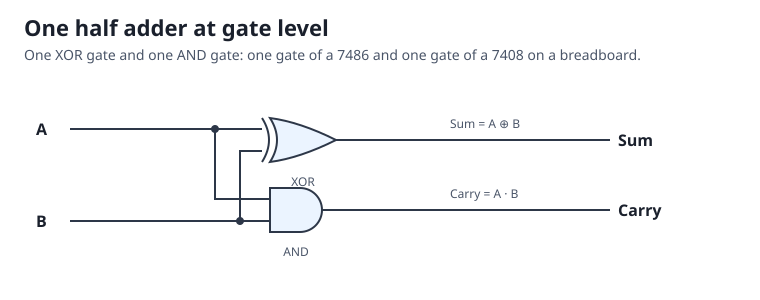
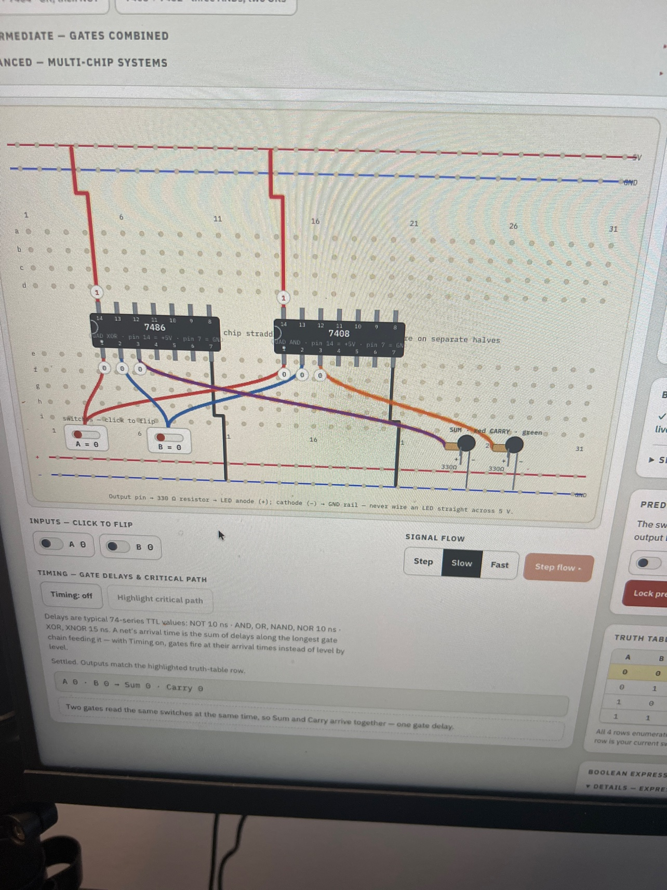
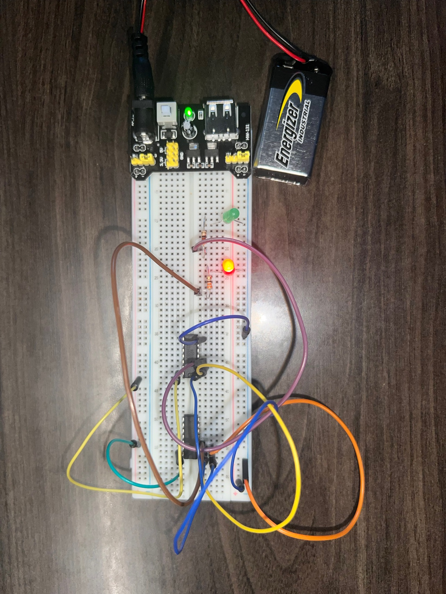
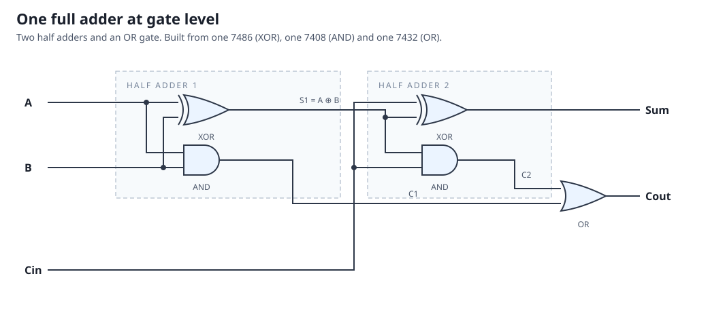
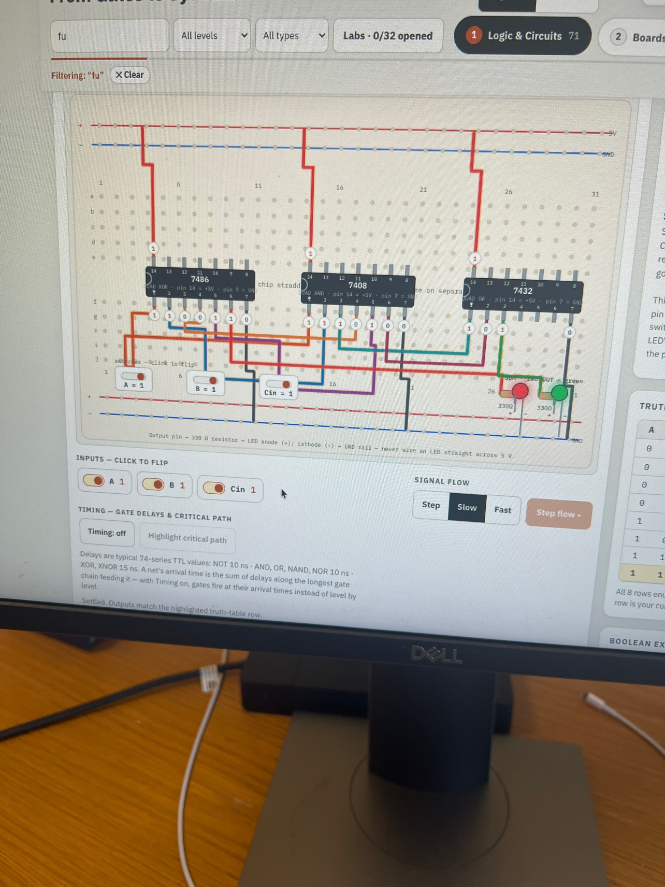
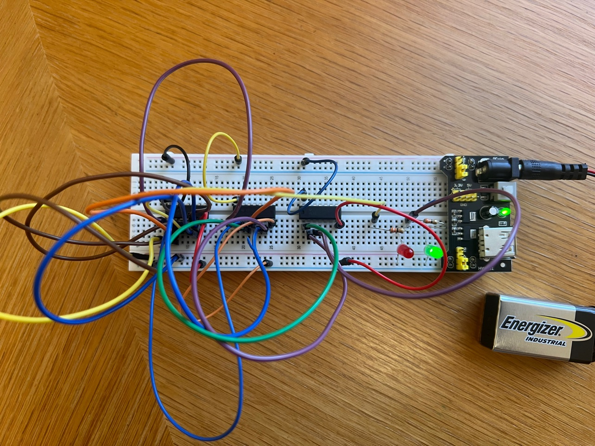
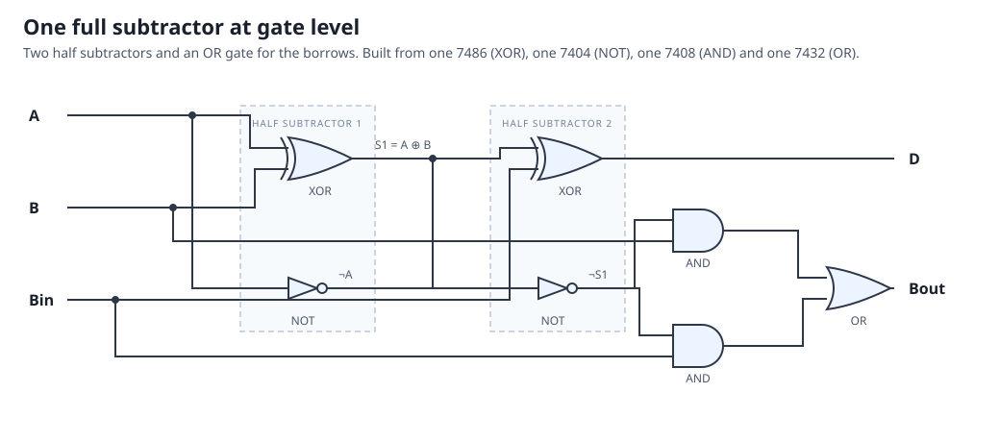
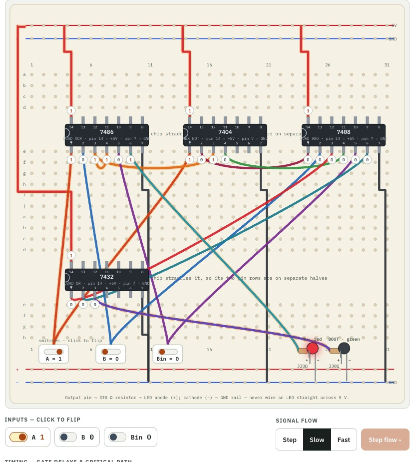
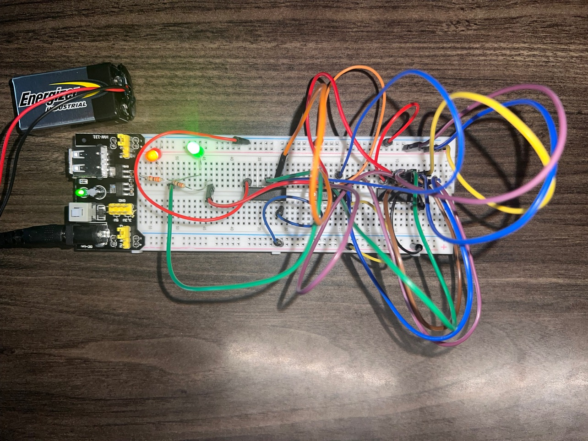

# Module: Inside the ALU — Adders, Multipliers, and Dividers

**Pathway stage:** 04 · Datapath (the hardware the ISA runs on)
**Course:** SCIS 216 Computer Organization and Design (packaged from the Fall 2026 lecture and in-class activity sequence)
**Format:** Two 75-minute sessions or one 2–3 hour lab · **Level:** Introductory systems

## Why this module exists

Students meet `add`, `mult`, and `div` as instructions, and they meet AND, OR, and NOT as physical gates on a breadboard. This module connects the two: it follows one continuous path from logic gates, to an adder, to the repeated add-and-shift loop that *is* multiplication, and the subtract-and-shift loop that *is* division. By the end, the ALU is not a box labelled "does arithmetic"; it is a small amount of hardware the students have watched work, cycle by cycle, in mathematics, in C, and in MIPS.

It is the bridge module of the collection: the breadboard lab ends at individual gates, and this module begins exactly there.

## Learning objectives

By the end of this module, students can:

- Explain how signed and unsigned binary values are represented, and decide whether an addition or subtraction overflows under a stated interpretation.
- Describe an adder as a circuit built from logic gates, trace its carry path, and explain what a partitioned adder gives up and gains.
- Trace the basic shift-and-add multiplier cycle by cycle.
- Trace the optimized multiplier and name the hardware it saves (and what it does not save: cycles).
- Trace an optimized restoring divider and identify dividend, divisor, quotient, and remainder at every step.
- Relate hardware multiplication and division to MIPS `mult`, `div`, `mfhi`, and `mflo`, including why software must check for division by zero itself.
- Compare basic, optimized, and faster arithmetic designs in terms of cycles, hardware, area, power, and control complexity, and defend a design choice for a stated workload.

## Before you start

- **Simulator:** QtSpim (MIPS32). Follow the shared guide: [Installing QtSpim for MIPS32](../setup/qtspim-installation.md).
- **Prerequisites:** the QtSpim Intro module (registers, `andi`, `add`, `sll`, `srl`) and, ideally, the Logic Gates on a Breadboard module (AND, OR, NOT, truth tables).
- **No physical build is required.** The adder discussion in Part 1 is a diagram and simulation activity. Physical builds are documented below for the half adder (one 7486 alongside one 7408), the full adder (adding a 7432), and a full subtractor (adding a 7404); the 7486 is not in the breadboard lab's parts set. See `INSTRUCTOR_NOTES.md`.

## The module files

| File | What it is |
|------|------------|
| `traces.md` | The student worksheet: six parts with blank trace tables, design questions, the QtSpim tasks, a synthesis checkpoint, and expected final outputs for self-checking |
| `arithmetic_algorithms.c` | Both multiplication algorithms in C, with a self-checking `main` (worked example, worksheet values, and edge cases) |
| `multiplier.asm` | The basic shift-and-add loop in MIPS for QtSpim. Ships computing 6 × 3; students change the values to 9 × 6 |
| `division.asm` | MIPS `div` and the HI/LO registers, with a software divide-by-zero guard. Ships computing 17 ÷ 5; students change the values and then break the divisor on purpose |
| `diagrams/` | Eight diagrams drawn for this module: `adder.svg`, `half-adder-schematic.svg`, `full-adder-schematic.svg`, `full-subtractor-schematic.svg`, `alu-slice-schematic.svg`, `multiplier-basic.svg`, `multiplier-optimized.svg`, `divider-optimized.svg` |
| `images/` | `half-adder-breadboard.jpg`, `full-adder-breadboard.jpg`, and `full-subtractor-breadboard.jpg`: the instructor's physical builds of the half adder, the Part 1 full adder (working: 7486, 7408, and 7432 on a breadboard), and the full subtractor; the matching `*-breadboard-diagram.jpg` files are the breadboard wiring diagrams for the same circuits from From Gates to Systems; `alu-slice-breadboard-diagram.jpg` is the wiring diagram for a 1-bit ALU slice build still to come |
| `INSTRUCTOR_NOTES.md` | Pacing, the checkpoints that catch the common failures, the XOR/parts caution, and the publication boundary |

## The half adder: truth table, schematic, and a build you can follow

The half adder is where the full adder starts: one XOR gate for the sum bit and one AND gate for the carry, both reading the same two inputs at the same time. It has no carry-in, so it can only ever add the first column of an addition; the full adder in the next section exists to fix exactly that.

### The truth table

| A | B | Sum | Carry |
|---|---|-----|-------|
| 0 | 0 | 0 | 0 |
| 0 | 1 | 1 | 0 |
| 1 | 0 | 1 | 0 |
| 1 | 1 | 0 | 1 |

Sum is A ⊕ B: it is 1 when the inputs differ. Carry is A · B: it is 1 only when both inputs are 1.

### What you need

- One 7486 (quad XOR) and one 7408 (quad AND)
- A breadboard and jumper wires
- Two switches for A and B (or jumper wires you move between the ground and +5 V rails)
- Two LEDs: red for Sum, green for Carry
- Two 330 Ω resistors, one in series with each LED
- A 5 V supply

### The chips

Both chips are 14-pin quad two-input gates with the same pin pattern as the builds that follow: pin 14 is +5 V, pin 7 is ground, and the four gates are (pins 1, 2) → 3, (4, 5) → 6, (9, 10) → 8, and (12, 13) → 11. This build uses one gate of each chip:

| Gate | Inputs | Output | Signal |
|------|--------|--------|--------|
| 7486 gate 1 | pins 1, 2 | pin 3 | Sum = A ⊕ B |
| 7408 gate 1 | pins 1, 2 | pin 3 | Carry = A · B |

### Wiring, step by step

1. **Power first, but do not switch on yet.** Connect pin 14 of each chip to the +5 V rail and pin 7 of each chip to the ground rail.
2. **Inputs A and B.** Connect switch A to pin 1 of the 7486 and pin 1 of the 7408, and switch B to pin 2 of both chips. Each input is a single node feeding both gates: join the two pin strips with a short jumper and drive the joined node, because if the chips are wired to an input separately they can disagree about it, and the LEDs will report the disagreement.
3. **The Sum LED.** Sum comes out of the 7486's pin 3: connect pin 3 through a 330 Ω resistor to the red LED's anode (the longer leg), and the LED's cathode to the ground rail.
4. **The Carry LED.** Carry comes out of the 7408's pin 3: connect pin 3 through a 330 Ω resistor to the green LED's anode, cathode to the ground rail.
5. **Before you power it:** both chips have pin 14 on +5 V and pin 7 on ground; A reaches pin 1 of both chips and B reaches pin 2 of both; each LED's anode reaches its resistor and its cathode reaches ground. An input left unconnected is not a 0: it drifts, and the gates read it as a 1, so a 0 has to be a wire to the ground rail, not a wire removed. Then switch on.

The same circuit laid out on a breadboard, with every chip pin labelled: the breadboard diagram from [From Gates to Systems](https://ebukaoguchi.github.io/gates-to-systems/), showing A = B = 0 with both LEDs dark.

### Test it against the truth table

Set the two switches for each row and check the two LEDs:

| A | B | Sum LED (red) | Carry LED (green) |
|---|---|---------------|-------------------|
| 0 | 0 | off | off |
| 0 | 1 | on | off |
| 1 | 0 | on | off |
| 1 | 1 | off | on |

The photograph shows a sum row on the instructor's own build: exactly one input high, so the red Sum LED is lit and the green Carry LED is dark.

The same board is interactive in [From Gates to Systems](https://ebukaoguchi.github.io/gates-to-systems/), where the switches can be flipped and the highlighted truth-table row follows the inputs.

## The full adder: truth table, schematic, and a build you can follow

One full adder at gate level: two half adders and an OR gate. The first half adder adds A and B; the second adds that sum to the carry-in; the OR gate merges the two possible carries into the carry-out.

Each half adder on its own is one XOR gate and one AND gate: the XOR produces the sum bit, the AND the carry. The half adder's own breadboard build, from one gate each of a 7486 and a 7408, is the section immediately before this one.

### The truth table

| A | B | Cin | Sum | Cout |
|---|---|-----|-----|------|
| 0 | 0 | 0 | 0 | 0 |
| 0 | 0 | 1 | 1 | 0 |
| 0 | 1 | 0 | 1 | 0 |
| 0 | 1 | 1 | 0 | 1 |
| 1 | 0 | 0 | 1 | 0 |
| 1 | 0 | 1 | 0 | 1 |
| 1 | 1 | 0 | 0 | 1 |
| 1 | 1 | 1 | 1 | 1 |

Sum is A ⊕ B ⊕ Cin: it is 1 when an odd number of the inputs are 1. Cout is 1 when at least two of the inputs are 1: Cout = (A · B) + (Cin · (A ⊕ B)).

### What you need

- One 7486 (quad XOR), one 7408 (quad AND), one 7432 (quad OR)
- A breadboard and jumper wires
- Three switches for A, B, and Cin (or jumper wires you move between the ground and +5 V rails)
- Two LEDs: red for Sum, green for Cout
- Two 330 Ω resistors, one in series with each LED
- A 5 V supply

### The chips

All three chips are 14-pin quad two-input gates with the same pin pattern: pin 14 is +5 V, pin 7 is ground, and the four gates are (pins 1, 2) → 3, (4, 5) → 6, (9, 10) → 8, and (12, 13) → 11. This build uses five of the twelve gates:

| Gate | Inputs | Output | Signal |
|------|--------|--------|--------|
| 7486 gate 1 | pins 1, 2 | pin 3 | s1 = A ⊕ B |
| 7486 gate 2 | pins 4, 5 | pin 6 | Sum = s1 ⊕ Cin |
| 7408 gate 1 | pins 1, 2 | pin 3 | c1 = A · B |
| 7408 gate 2 | pins 4, 5 | pin 6 | c2 = s1 · Cin |
| 7432 gate 1 | pins 1, 2 | pin 3 | Cout = c1 + c2 |

### Wiring, step by step

1. **Power first, but do not switch on yet.** Connect pin 14 of each chip to the +5 V rail and pin 7 of each chip to the ground rail.
2. **Inputs A and B.** Connect switch A to pin 1 of the 7486 and pin 1 of the 7408. Connect switch B to pin 2 of both chips. A and B each feed two gates: the first XOR and the first AND.
3. **The middle signal, s1.** The 7486's pin 3 is s1 = A ⊕ B. Connect it to pin 4 of the 7486 and pin 4 of the 7408, where the second half adder picks it up.
4. **Input Cin and the Sum LED.** Connect switch Cin to pin 5 of the 7486 and pin 5 of the 7408. Sum comes out of the 7486's pin 6: connect pin 6 through a 330 Ω resistor to the red LED's anode (the longer leg), and the LED's cathode to the ground rail.
5. **The two carries and Cout.** The 7408's pin 3 is c1 = A · B; connect it to pin 1 of the 7432. The 7408's pin 6 is c2 = s1 · Cin; connect it to pin 2 of the 7432. Cout comes out of the 7432's pin 3: connect pin 3 through a 330 Ω resistor to the green LED's anode, cathode to the ground rail.
6. **Before you power it:** every chip has pin 14 on +5 V and pin 7 on ground; every output pin feeds only input pins or an LED through its resistor; each LED's anode reaches its resistor and its cathode reaches ground. Then switch on.

The same circuit laid out on a breadboard, with every chip pin labelled: the breadboard diagram from [From Gates to Systems](https://ebukaoguchi.github.io/gates-to-systems/). Note the second XOR gate on the 7486: its inputs are pins 4 and 5, and Sum comes out of pin 6.

### Test it against the truth table

Set the three switches for each row and check the two LEDs:

| A | B | Cin | Sum LED (red) | Cout LED (green) |
|---|---|-----|---------------|------------------|
| 0 | 0 | 0 | off | off |
| 0 | 0 | 1 | on | off |
| 0 | 1 | 0 | on | off |
| 0 | 1 | 1 | off | on |
| 1 | 0 | 0 | on | off |
| 1 | 0 | 1 | off | on |
| 1 | 1 | 0 | off | on |
| 1 | 1 | 1 | on | on |

The photograph shows the last row, A = B = Cin = 1, on the instructor's own build: both LEDs lit, Sum = 1 and Cout = 1.

The same board is interactive in [From Gates to Systems](https://ebukaoguchi.github.io/gates-to-systems/), where the switches can be flipped and the highlighted truth-table row follows the inputs. The site carries more breadboard projects in the same style, including a half adder built from a 7486 and a 7408, for students who want to keep wiring.

## The full subtractor: truth table, schematic, and a build you can follow

The full adder's mirror. Where the full adder adds a carry-in, the full subtractor subtracts a borrow-in: two half subtractors in series, the first taking B from A, the second taking Bin from that result. Either stage can demand a borrow, so the two borrow terms meet in an OR gate, exactly where the full adder's two carries meet.

### The truth table

| A | B | Bin | D | Bout |
|---|---|-----|---|------|
| 0 | 0 | 0 | 0 | 0 |
| 0 | 0 | 1 | 1 | 1 |
| 0 | 1 | 0 | 1 | 1 |
| 0 | 1 | 1 | 0 | 1 |
| 1 | 0 | 0 | 1 | 0 |
| 1 | 0 | 1 | 0 | 0 |
| 1 | 1 | 0 | 0 | 0 |
| 1 | 1 | 1 | 1 | 1 |

D is A ⊕ B ⊕ Bin: it is 1 when an odd number of the inputs are 1. Bout is 1 whenever B + Bin is more than A has to give: Bout = (¬A · B) + (¬(A ⊕ B) · Bin).

### What you need

- One 7486 (quad XOR), one 7404 (hex inverter), one 7408 (quad AND), and one 7432 (quad OR)
- A breadboard and jumper wires
- Three switches for A, B, and Bin (or jumper wires you move between the ground and +5 V rails)
- Two LEDs: red for D, green for Bout
- Two 330 Ω resistors, one in series with each LED
- A 5 V supply

### The chips

Three of the chips are 14-pin quad two-input gates with the usual pattern: pin 14 is +5 V, pin 7 is ground, and the gates are (pins 1, 2) → 3, (4, 5) → 6, (9, 10) → 8, and (12, 13) → 11. The 7404's inverters are single-input gates: pin 1 → 2, pin 3 → 4, and so on. This build uses seven gates:

| Gate | Inputs | Output | Signal |
|------|--------|--------|--------|
| 7486 gate 1 | pins 1, 2 | pin 3 | s1 = A ⊕ B |
| 7486 gate 2 | pins 4, 5 | pin 6 | D = s1 ⊕ Bin |
| 7404 inverter 1 | pin 1 | pin 2 | ¬A |
| 7404 inverter 2 | pin 3 | pin 4 | ¬s1 |
| 7408 gate 1 | pins 1, 2 | pin 3 | b1 = ¬A · B |
| 7408 gate 2 | pins 4, 5 | pin 6 | b2 = ¬s1 · Bin |
| 7432 gate 1 | pins 1, 2 | pin 3 | Bout = b1 + b2 |

### Wiring, step by step

1. **Power first, but do not switch on yet.** Connect pin 14 of each of the four chips to the +5 V rail and pin 7 of each chip to the ground rail.
2. **Inputs A and B, and the first difference.** Connect switch A to pin 1 of the 7486 and switch B to pin 2; s1 = A ⊕ B leaves pin 3. Connect A also to pin 1 of the 7404: ¬A leaves pin 2. As in the builds before this one, each input is a single node: join the strips it feeds and drive the joined node.
3. **The second stage.** Connect s1 (the 7486's pin 3) to pin 4 of the 7486 and switch Bin to pin 5; D leaves pin 6: connect pin 6 through a 330 Ω resistor to the red LED's anode, cathode to the ground rail. Connect s1 also to pin 3 of the 7404: ¬s1 leaves pin 4.
4. **The two borrows.** Connect ¬A to pin 1 of the 7408 and B to pin 2 (b1 at pin 3). Connect ¬s1 to pin 4 of the 7408 and Bin to pin 5 (b2 at pin 6).
5. **Bout and its LED.** Connect b1 to pin 1 of the 7432 and b2 to pin 2; Bout leaves pin 3: connect pin 3 through a 330 Ω resistor to the green LED's anode, cathode to the ground rail.
6. **Before you power it:** every chip has pin 14 on +5 V and pin 7 on ground; A reaches both of its pins (7486 pin 1, 7404 pin 1), B reaches both of its (7486 pin 2, 7408 pin 2), and Bin reaches both of its (7486 pin 5, 7408 pin 5); no output pin is tied to a rail; each LED's anode reaches its resistor and its cathode reaches ground. An input left unconnected is not a 0: it drifts, and the gates read it as a 1. Then switch on.

The same circuit laid out on a breadboard, with every chip pin labelled: the breadboard diagram from [From Gates to Systems](https://ebukaoguchi.github.io/gates-to-systems/), showing A = 1, B = 0, Bin = 0: 1 − 0 − 0 = 1, so the red D LED is lit and Bout is dark.

### Test it against the truth table

Set the three switches for each row and check the two LEDs:

| A | B | Bin | D LED (red) | Bout LED (green) |
|---|---|-----|-------------|------------------|
| 0 | 0 | 0 | off | off |
| 0 | 0 | 1 | on | on |
| 0 | 1 | 0 | on | on |
| 0 | 1 | 1 | off | on |
| 1 | 0 | 0 | on | off |
| 1 | 0 | 1 | off | off |
| 1 | 1 | 0 | off | off |
| 1 | 1 | 1 | on | on |

The photograph shows the instructor's own build of the subtractor: all four chips on one breadboard.

The same board is interactive in [From Gates to Systems](https://ebukaoguchi.github.io/gates-to-systems/), where the switches can be flipped and the highlighted truth-table row follows the inputs.

## Staged milestones

**Milestone 1 — Numbers the hardware can hold (worksheet Part 0).** Eight-bit addition and subtraction under signed and unsigned interpretations. The deliverable insight: overflow is a property of the pattern *plus* the interpretation, and `add` and `addu` are the same hardware making different promises. *Checkpoint: every overflow decision is justified in one sentence.*

**Milestone 2 — From gates to an adder (Part 1).** Label the full adder, follow the carry chain, then block the carries to get a partitioned adder and reason about who benefits (multimedia lanes) and what is lost. *Checkpoint: the carry path is traced without prompting.*

**Milestone 3 — The basic multiplier (Part 2).** A completed 6 × 3 demonstration trace, then the student's own 9 × 6 trace. The loop, stated in register names: the multiplier decides, the multiplicand moves, the product accumulates. *Checkpoint: the student can predict the number of additions from the multiplier's bits before tracing.*

**Milestone 4 — The same algorithm in code (Part 6a, with `arithmetic_algorithms.c`).** The C and MIPS versions of the loop are matched instruction by instruction against the hardware steps, then run in QtSpim with the worksheet's values. *Checkpoint: the QtSpim output matches the hand trace.*

**Milestone 5 — The optimized multiplier (Part 3).** The multiplier moves inside the product register; students trace 10 × 5 in the combined register and name precisely what hardware disappeared. *Checkpoint: the student states, unprompted, that the saving is hardware, not cycles.*

**Milestone 6 — Faster designs and trade-offs (Part 4).** Parallel partial products with many adders; a completed comparison table; two design-defence paragraphs (a coin-cell sensor node, a phone processor). *Checkpoint: each defence names a cost, not only a benefit.*

**Milestone 7 — Division (Parts 5 and 6b).** Trial subtraction, restore-or-keep, one quotient bit per cycle; a 13 ÷ 3 trace; then the same split in MIPS, where the remainder and quotient surface as HI and LO, and the divide-by-zero check turns out to be software's job. *Checkpoint: divisor × quotient + remainder is verified against the dividend.*

## Deliverables

Students submit, per the synthesis checkpoint in `traces.md`:

- The completed multiplier, optimized-multiplier, and divider traces
- The completed design comparison and two scenario paragraphs
- The matched C-to-MIPS instruction list and one modified run of each QtSpim program
- One paragraph answering: "An adder, a multiplier, and a divider are all built from the same few operations. What differs between them?"

## What is, and is not, in this package

The package contains the module specification, the student worksheet with **expected final outputs only**, two verified code files in each of C and MIPS, and diagrams drawn for this module. The cycle-by-cycle answers to the worksheet's own exercises are not published, so the traces remain gradeable as evidence of process.

The Fall 2026 lecture decks the module was packaged from are **not** included: they mix textbook chapter material and diagrams with the instructor's activities, and two of them carry completed solutions to in-class tasks that an instructor may still run live. The worked examples published here (6 × 3 in both multiplier designs, 17 ÷ 5 in MIPS) are the lecture demonstrations, included in full on purpose.

Floating-point arithmetic, which the same lecture sequence covers after division, is deliberately out of scope: it is a representation topic and is planned as a separate follow-on module.

## Source material

Packaged from the Fall 2026 SCIS 216 sequence: Week 1 (number systems, two's complement, overflow), Lecture 002 (MIPS instructions, encoding, shifts, and logical operations), and Lecture 003 (addition and subtraction, adders and partitioned adders, the three multiplier designs, division hardware, and MIPS HI/LO), accompanying Patterson & Hennessy, *Computer Organization and Design*, 6th ed., chapters 2–3.

---

*Part of the Systems Labs collection: laboratory modules for computer organization, architecture, and operating systems, maintained by Ebuka Philip Oguchi, Spelman College. Modules may be adopted and remixed with attribution.*
