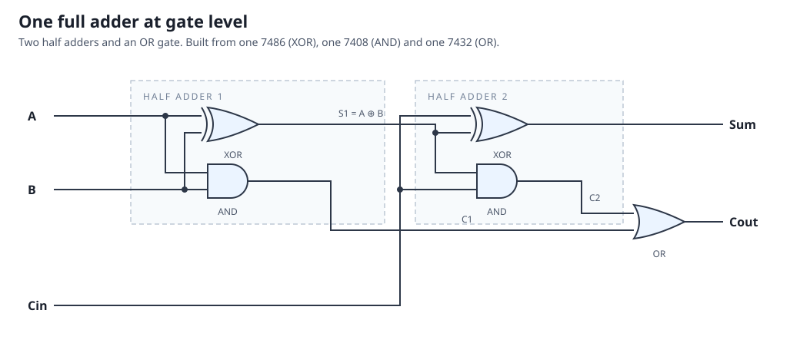
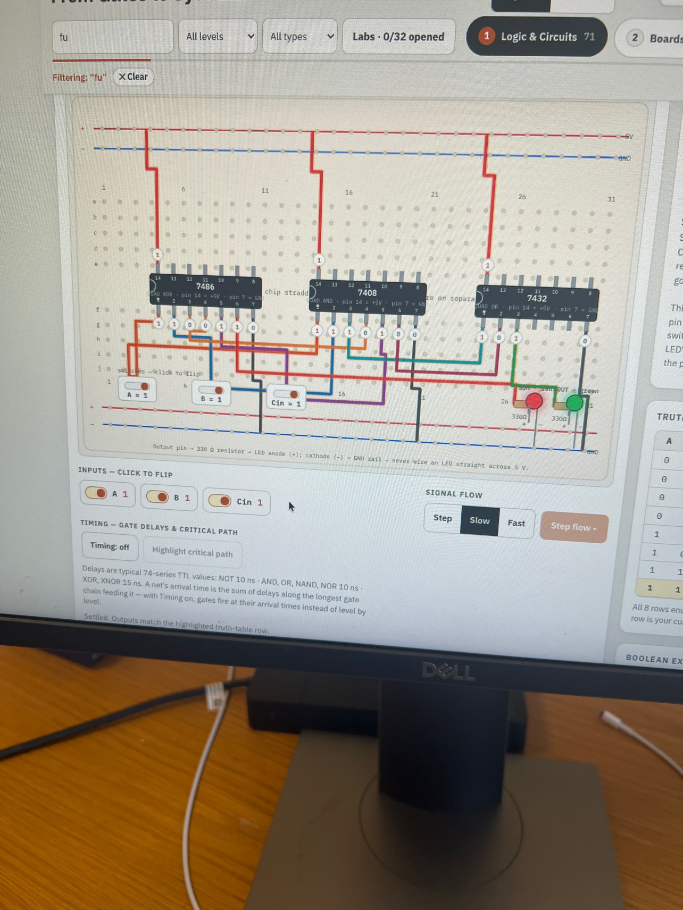
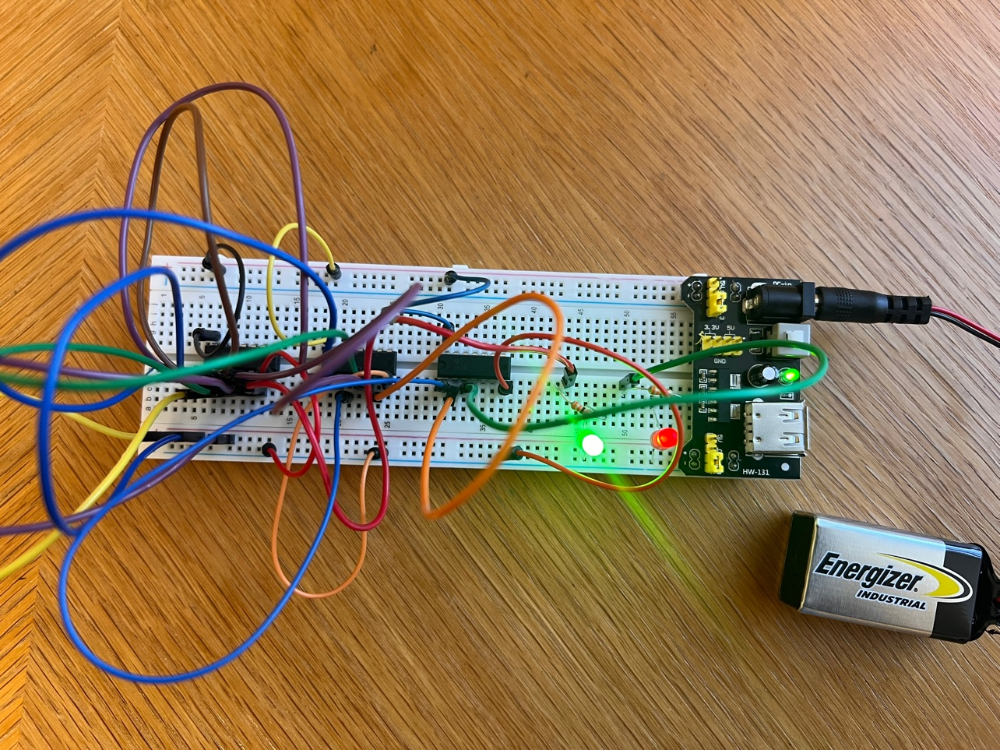

# Module: The Full Adder — Two Half Adders, One Carry Chain

**Pathway stage:** 04 · Datapath (the hardware the ISA runs on)
**Course:** SCIS 216 Computer Organization and Design (packaged from the Fall 2026 lecture and in-class activity sequence)
**Format:** One bench session · **Level:** Introductory systems

**The arithmetic datapath group:** build 2 of 4. The shared introduction, worksheet, and arithmetic algorithms live in [Inside the ALU](../module-arithmetic-datapath/).
**Previous:** [The Half Adder](../module-half-adder/) · **Next:** [The Half Subtractor](../module-half-subtractor/)

## Why this module exists

The full adder is the column real addition is built from: two half adders and an OR gate, taking the carry-in the half adder cannot accept. The first half adder adds A and B; the second adds that sum to the carry-in; the OR gate merges the two possible carries into the carry-out. Chained column by column, these are the ripple-carry adder that [Inside the ALU](../module-arithmetic-datapath/) traces.

## Learning objectives

By the end of this module, students can:

- Build a full adder from two half adders and an OR gate (7486, 7408, 7432), following the pin table for s1 and the two carry terms c1 and c2.
- Verify all eight rows of the full adder's truth table on the two LEDs, including the A = B = Cin = 1 row, where Sum and Cout are both 1.
- Explain how full adder columns chain into a ripple-carry adder, and why the carry path, not the gates in one column, sets the speed of the whole adder.

## Before you start

- **Prerequisites:** the Half Adder module ([module-half-adder](../module-half-adder/)) — this build is two of those, plus an OR gate.
- **Parts:** one 7486 (quad XOR), one 7408 (quad AND), and one 7432 (quad OR), a breadboard and jumper wires, three switches for A, B, and Cin, two LEDs (red for Sum, green for Cout) with a 330 Ω resistor in series with each, and a 5 V supply.

## The module files

| File | What it is |
|------|------------|
| `README.md` | This file: the truth table, the schematic, and the build, step by step |
| `diagrams/full-adder-schematic.svg` | The gate-level schematic: two half adders and an OR gate |
| `images/full-adder-breadboard.jpg` | The instructor's build on a breadboard, showing the A = B = Cin = 1 row (both LEDs lit) |
| `images/full-adder-breadboard-diagram.jpg` | The breadboard wiring diagram from From Gates to Systems, with every chip pin labelled |

One full adder at gate level: two half adders and an OR gate. The first half adder adds A and B; the second adds that sum to the carry-in; the OR gate merges the two possible carries into the carry-out.

Each half adder on its own is one XOR gate and one AND gate: the XOR produces the sum bit, the AND the carry. The half adder's own breadboard build, from one gate each of a 7486 and a 7408, is in [the Half Adder module](../module-half-adder/).

## The truth table

| A | B | Cin | Sum | Cout |
|---|---|-----|-----|------|
| 0 | 0 | 0 | 0 | 0 |
| 0 | 0 | 1 | 1 | 0 |
| 0 | 1 | 0 | 1 | 0 |
| 0 | 1 | 1 | 0 | 1 |
| 1 | 0 | 0 | 1 | 0 |
| 1 | 0 | 1 | 0 | 1 |
| 1 | 1 | 0 | 0 | 1 |
| 1 | 1 | 1 | 1 | 1 |

Sum is A ⊕ B ⊕ Cin: it is 1 when an odd number of the inputs are 1. Cout is 1 when at least two of the inputs are 1: Cout = (A · B) + (Cin · (A ⊕ B)).

## What you need

- One 7486 (quad XOR), one 7408 (quad AND), one 7432 (quad OR)
- A breadboard and jumper wires
- Three switches for A, B, and Cin (or jumper wires you move between the ground and +5 V rails)
- Two LEDs: red for Sum, green for Cout
- Two 330 Ω resistors, one in series with each LED
- A 5 V supply

## The chips

All three chips are 14-pin quad two-input gates with the same pin pattern: pin 14 is +5 V, pin 7 is ground, and the four gates are (pins 1, 2) → 3, (4, 5) → 6, (9, 10) → 8, and (12, 13) → 11. This build uses five of the twelve gates:

| Gate | Inputs | Output | Signal |
|------|--------|--------|--------|
| 7486 gate 1 | pins 1, 2 | pin 3 | s1 = A ⊕ B |
| 7486 gate 2 | pins 4, 5 | pin 6 | Sum = s1 ⊕ Cin |
| 7408 gate 1 | pins 1, 2 | pin 3 | c1 = A · B |
| 7408 gate 2 | pins 4, 5 | pin 6 | c2 = s1 · Cin |
| 7432 gate 1 | pins 1, 2 | pin 3 | Cout = c1 + c2 |

## Wiring, step by step

1. **Power first, but do not switch on yet.** Connect pin 14 of each chip to the +5 V rail and pin 7 of each chip to the ground rail.
2. **Inputs A and B.** Connect switch A to pin 1 of the 7486 and pin 1 of the 7408. Connect switch B to pin 2 of both chips. A and B each feed two gates: the first XOR and the first AND.
3. **The middle signal, s1.** The 7486's pin 3 is s1 = A ⊕ B. Connect it to pin 4 of the 7486 and pin 4 of the 7408, where the second half adder picks it up.
4. **Input Cin and the Sum LED.** Connect switch Cin to pin 5 of the 7486 and pin 5 of the 7408. Sum comes out of the 7486's pin 6: connect pin 6 through a 330 Ω resistor to the red LED's anode (the longer leg), and the LED's cathode to the ground rail.
5. **The two carries and Cout.** The 7408's pin 3 is c1 = A · B; connect it to pin 1 of the 7432. The 7408's pin 6 is c2 = s1 · Cin; connect it to pin 2 of the 7432. Cout comes out of the 7432's pin 3: connect pin 3 through a 330 Ω resistor to the green LED's anode, cathode to the ground rail.
6. **Before you power it:** every chip has pin 14 on +5 V and pin 7 on ground; every output pin feeds only input pins or an LED through its resistor; each LED's anode reaches its resistor and its cathode reaches ground. Then switch on.

The same circuit laid out on a breadboard, with every chip pin labelled: the breadboard diagram from [From Gates to Systems](https://ebukaoguchi.github.io/gates-to-systems/). Note the second XOR gate on the 7486: its inputs are pins 4 and 5, and Sum comes out of pin 6.

## Test it against the truth table

Set the three switches for each row and check the two LEDs:

| A | B | Cin | Sum LED (red) | Cout LED (green) |
|---|---|-----|---------------|------------------|
| 0 | 0 | 0 | off | off |
| 0 | 0 | 1 | on | off |
| 0 | 1 | 0 | on | off |
| 0 | 1 | 1 | off | on |
| 1 | 0 | 0 | on | off |
| 1 | 0 | 1 | off | on |
| 1 | 1 | 0 | off | on |
| 1 | 1 | 1 | on | on |

The photograph shows the last row, A = B = Cin = 1, on the instructor's own build: both LEDs lit, Sum = 1 and Cout = 1.

The same board is interactive in [From Gates to Systems](https://ebukaoguchi.github.io/gates-to-systems/), where the switches can be flipped and the highlighted truth-table row follows the inputs. The site carries more breadboard projects in the same style, including a half adder built from a 7486 and a 7408, for students who want to keep wiring.

## The datapath group

This build is one of four breadboard builds in the arithmetic datapath group, taken in build order:

1. [The Half Adder](../module-half-adder/) — one XOR gate and one AND gate: the first column of addition.
2. [The Full Adder](../module-full-adder/) — two half adders and an OR gate: addition with a carry-in.
3. [The Half Subtractor](../module-half-subtractor/) — an XOR, an inverter, and an AND gate: difference and borrow for one column.
4. [The Full Subtractor](../module-full-subtractor/) — two half subtractors in series: subtraction with a borrow-in.

The shared introduction, worksheet, and arithmetic algorithms for the group live in [Inside the ALU](../module-arithmetic-datapath/), which carries the story on into the multiplier and divider designs.

---

*Part of the Systems Labs collection: laboratory modules for computer organization, architecture, and operating systems, maintained by Ebuka Philip Oguchi, Spelman College. Modules may be adopted and remixed with attribution.*
