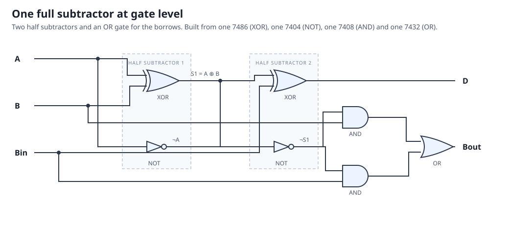
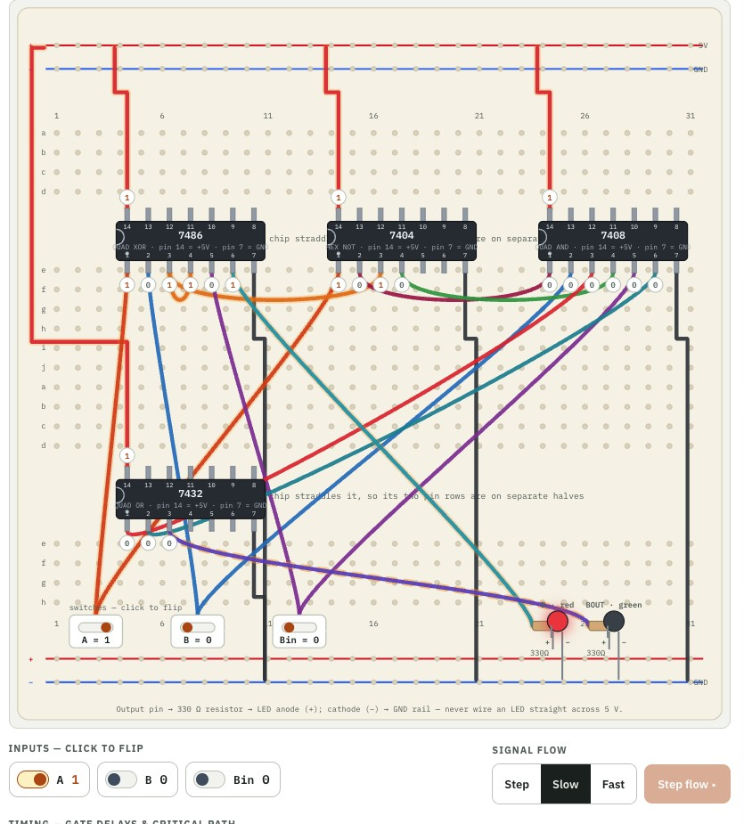
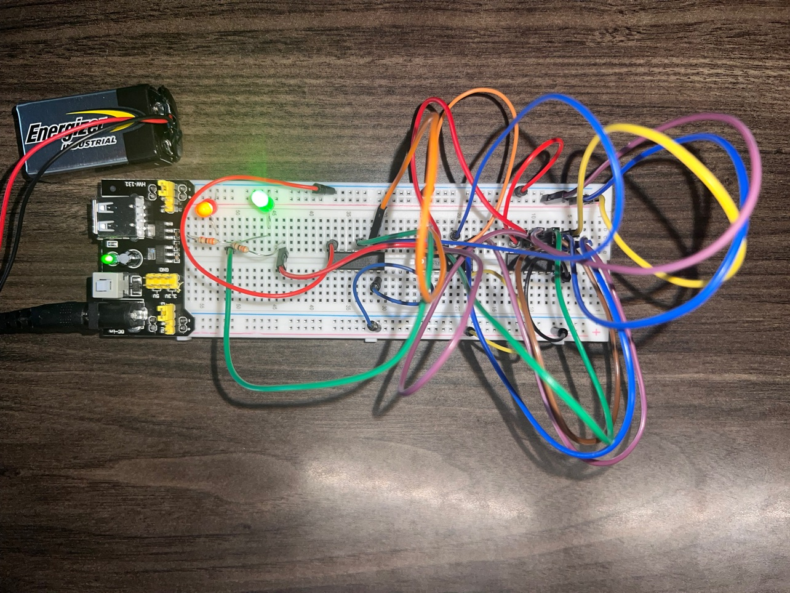

# Module: The Full Subtractor — Subtraction with a Borrow-In

**Pathway stage:** 04 · Datapath (the hardware the ISA runs on)
**Course:** SCIS 216 Computer Organization and Design (packaged from the Fall 2026 lecture and in-class activity sequence)
**Format:** One bench session · **Level:** Introductory systems

**The arithmetic datapath group:** build 4 of 4. The shared introduction, worksheet, and arithmetic algorithms live in [Inside the ALU](../module-arithmetic-datapath/).
**Previous:** [The Half Subtractor](../module-half-subtractor/) · **Next:** the multiplier and divider designs in [Inside the ALU](../module-arithmetic-datapath/)

## Why this module exists

The full subtractor completes the group's breadboard builds: it is the full adder's mirror, subtracting a borrow-in where the adder adds a carry-in. Two half subtractors in series — the first taking B from A, the second taking Bin from that result — with the two borrow terms meeting in an OR gate, exactly where the full adder's two carries meet. After this build, every operation inside the ALU's add/subtract hardware has been wired by hand at least once.

## Learning objectives

By the end of this module, students can:

- Build a full subtractor from two half subtractors in series (7486, 7404, 7408, 7432), forming both borrow terms, b1 and b2, and merging them in an OR gate.
- Verify all eight rows of the full subtractor's truth table on the two LEDs, including the rows where the borrow is demanded by the second stage rather than the first.
- State the full subtractor's two identities from the circuit — D = A ⊕ B ⊕ Bin and Bout = (¬A · B) + (¬(A ⊕ B) · Bin) — and set the build beside the full adder: the same two-stage shape, with borrow where the adder has carry.

## Before you start

- **Prerequisites:** the Half Subtractor module ([module-half-subtractor](../module-half-subtractor/)) — this build is two of those, plus an OR gate.
- **Parts:** one 7486 (quad XOR), one 7404 (hex inverter), one 7408 (quad AND), and one 7432 (quad OR), a breadboard and jumper wires, three switches for A, B, and Bin, two LEDs (red for D, green for Bout) with a 330 Ω resistor in series with each, and a 5 V supply.

## The module files

| File | What it is |
|------|------------|
| `README.md` | This file: the truth table, the schematic, and the build, step by step |
| `diagrams/full-subtractor-schematic.svg` | The gate-level schematic: two half subtractors and an OR gate |
| `images/full-subtractor-breadboard.jpg` | The instructor's build: all four chips on one breadboard, with both LEDs lit |
| `images/full-subtractor-breadboard-diagram.jpg` | The breadboard wiring diagram from From Gates to Systems, with every chip pin labelled |

The full adder's mirror. Where the full adder adds a carry-in, the full subtractor subtracts a borrow-in: two half subtractors in series, the first taking B from A, the second taking Bin from that result. Either stage can demand a borrow, so the two borrow terms meet in an OR gate, exactly where the full adder's two carries meet.

## The truth table

| A | B | Bin | D | Bout |
|---|---|-----|---|------|
| 0 | 0 | 0 | 0 | 0 |
| 0 | 0 | 1 | 1 | 1 |
| 0 | 1 | 0 | 1 | 1 |
| 0 | 1 | 1 | 0 | 1 |
| 1 | 0 | 0 | 1 | 0 |
| 1 | 0 | 1 | 0 | 0 |
| 1 | 1 | 0 | 0 | 0 |
| 1 | 1 | 1 | 1 | 1 |

D is A ⊕ B ⊕ Bin: it is 1 when an odd number of the inputs are 1. Bout is 1 whenever B + Bin is more than A has to give: Bout = (¬A · B) + (¬(A ⊕ B) · Bin).

## What you need

- One 7486 (quad XOR), one 7404 (hex inverter), one 7408 (quad AND), and one 7432 (quad OR)
- A breadboard and jumper wires
- Three switches for A, B, and Bin (or jumper wires you move between the ground and +5 V rails)
- Two LEDs: red for D, green for Bout
- Two 330 Ω resistors, one in series with each LED
- A 5 V supply

## The chips

Three of the chips are 14-pin quad two-input gates with the usual pattern: pin 14 is +5 V, pin 7 is ground, and the gates are (pins 1, 2) → 3, (4, 5) → 6, (9, 10) → 8, and (12, 13) → 11. The 7404's inverters are single-input gates: pin 1 → 2, pin 3 → 4, and so on. This build uses seven gates:

| Gate | Inputs | Output | Signal |
|------|--------|--------|--------|
| 7486 gate 1 | pins 1, 2 | pin 3 | s1 = A ⊕ B |
| 7486 gate 2 | pins 4, 5 | pin 6 | D = s1 ⊕ Bin |
| 7404 inverter 1 | pin 1 | pin 2 | ¬A |
| 7404 inverter 2 | pin 3 | pin 4 | ¬s1 |
| 7408 gate 1 | pins 1, 2 | pin 3 | b1 = ¬A · B |
| 7408 gate 2 | pins 4, 5 | pin 6 | b2 = ¬s1 · Bin |
| 7432 gate 1 | pins 1, 2 | pin 3 | Bout = b1 + b2 |

## Wiring, step by step

1. **Power first, but do not switch on yet.** Connect pin 14 of each of the four chips to the +5 V rail and pin 7 of each chip to the ground rail.
2. **Inputs A and B, and the first difference.** Connect switch A to pin 1 of the 7486 and switch B to pin 2; s1 = A ⊕ B leaves pin 3. Connect A also to pin 1 of the 7404: ¬A leaves pin 2. As in the builds before this one, each input is a single node: join the strips it feeds and drive the joined node.
3. **The second stage.** Connect s1 (the 7486's pin 3) to pin 4 of the 7486 and switch Bin to pin 5; D leaves pin 6: connect pin 6 through a 330 Ω resistor to the red LED's anode, cathode to the ground rail. Connect s1 also to pin 3 of the 7404: ¬s1 leaves pin 4.
4. **The two borrows.** Connect ¬A to pin 1 of the 7408 and B to pin 2 (b1 at pin 3). Connect ¬s1 to pin 4 of the 7408 and Bin to pin 5 (b2 at pin 6).
5. **Bout and its LED.** Connect b1 to pin 1 of the 7432 and b2 to pin 2; Bout leaves pin 3: connect pin 3 through a 330 Ω resistor to the green LED's anode, cathode to the ground rail.
6. **Before you power it:** every chip has pin 14 on +5 V and pin 7 on ground; A reaches both of its pins (7486 pin 1, 7404 pin 1), B reaches both of its (7486 pin 2, 7408 pin 2), and Bin reaches both of its (7486 pin 5, 7408 pin 5); no output pin is tied to a rail; each LED's anode reaches its resistor and its cathode reaches ground. An input left unconnected is not a 0: it drifts, and the gates read it as a 1. Then switch on.

The same circuit laid out on a breadboard, with every chip pin labelled: the breadboard diagram from [From Gates to Systems](https://ebukaoguchi.github.io/gates-to-systems/), showing A = 1, B = 0, Bin = 0: 1 − 0 − 0 = 1, so the red D LED is lit and Bout is dark.

## Test it against the truth table

Set the three switches for each row and check the two LEDs:

| A | B | Bin | D LED (red) | Bout LED (green) |
|---|---|-----|-------------|------------------|
| 0 | 0 | 0 | off | off |
| 0 | 0 | 1 | on | on |
| 0 | 1 | 0 | on | on |
| 0 | 1 | 1 | off | on |
| 1 | 0 | 0 | on | off |
| 1 | 0 | 1 | off | off |
| 1 | 1 | 0 | off | off |
| 1 | 1 | 1 | on | on |

The photograph shows the instructor's own build of the subtractor: all four chips on one breadboard.

The same board is interactive in [From Gates to Systems](https://ebukaoguchi.github.io/gates-to-systems/), where the switches can be flipped and the highlighted truth-table row follows the inputs.

## The datapath group

This build is one of four breadboard builds in the arithmetic datapath group, taken in build order:

1. [The Half Adder](../module-half-adder/) — one XOR gate and one AND gate: the first column of addition.
2. [The Full Adder](../module-full-adder/) — two half adders and an OR gate: addition with a carry-in.
3. [The Half Subtractor](../module-half-subtractor/) — an XOR, an inverter, and an AND gate: difference and borrow for one column.
4. [The Full Subtractor](../module-full-subtractor/) — two half subtractors in series: subtraction with a borrow-in.

The shared introduction, worksheet, and arithmetic algorithms for the group live in [Inside the ALU](../module-arithmetic-datapath/), which carries the story on into the multiplier and divider designs.

---

*Part of the Systems Labs collection: laboratory modules for computer organization, architecture, and operating systems, maintained by Ebuka Philip Oguchi, Spelman College. Modules may be adopted and remixed with attribution.*
