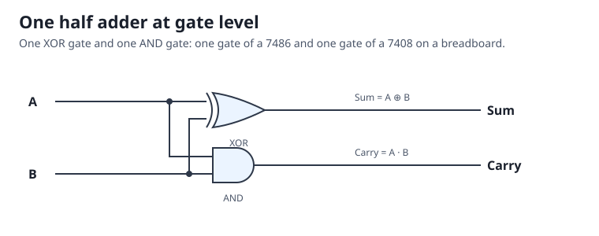
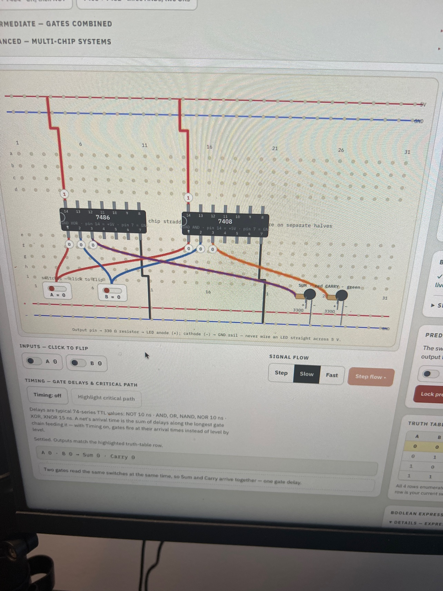
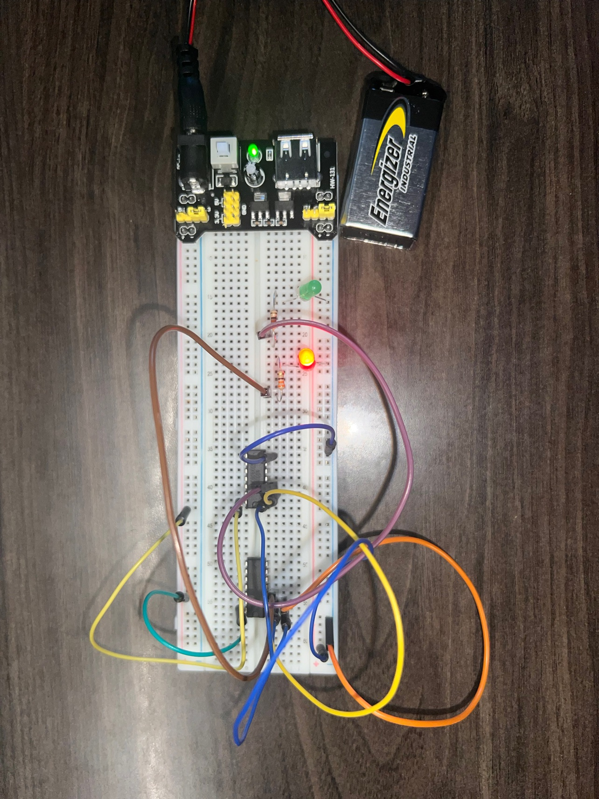

# Module: The Half Adder — One XOR, One AND, and the First Column of Addition

**Pathway stage:** 04 · Datapath (the hardware the ISA runs on)
**Course:** SCIS 216 Computer Organization and Design (packaged from the Fall 2026 lecture and in-class activity sequence)
**Format:** One bench session · **Level:** Introductory systems

**The arithmetic datapath group:** build 1 of 4. The shared introduction, worksheet, and arithmetic algorithms live in [Inside the ALU](../module-arithmetic-datapath/).
**Next:** [The Full Adder](../module-full-adder/)

## Why this module exists

The half adder is the first arithmetic circuit in the datapath group: one XOR gate for the sum bit and one AND gate for the carry, both reading the same two inputs at the same time. It has no carry-in, so it can only ever add the first column of an addition — [the full adder](../module-full-adder/) exists to fix exactly that. It is also the group's first build beyond the breadboard lab's parts set: it needs the 7486 XOR chip, which that lab does not use.

## Learning objectives

By the end of this module, students can:

- Build a half adder on a breadboard from one 7486 (quad XOR) and one 7408 (quad AND), wiring each input as a single node that feeds both chips.
- Verify all four rows of the half adder's truth table on the two LEDs, naming which LED is Sum and which is Carry in each row.
- Explain why a half adder cannot accept a carry-in, and so can only ever add the first column of an addition — the limitation the full adder fixes.

## Before you start

- **Prerequisites:** the Logic Gates on a Breadboard module ([module-logic-gates-breadboard](../module-logic-gates-breadboard/)) — AND, OR, NOT, truth tables, and the single-node wiring habit.
- **Parts:** one 7486 (quad XOR) and one 7408 (quad AND), a breadboard and jumper wires, two switches for A and B, two LEDs (red for Sum, green for Carry) with a 330 Ω resistor in series with each, and a 5 V supply. The 7486 is not in the breadboard lab's parts set; see the instructor notes in [Inside the ALU](../module-arithmetic-datapath/).

## The module files

| File | What it is |
|------|------------|
| `README.md` | This file: the truth table, the schematic, and the build, step by step |
| `diagrams/half-adder-schematic.svg` | The gate-level schematic: one XOR gate and one AND gate |
| `images/half-adder-breadboard.jpg` | The instructor's build on a breadboard, showing a sum row (red Sum LED lit) |
| `images/half-adder-breadboard-diagram.jpg` | The breadboard wiring diagram from From Gates to Systems, with every chip pin labelled |

The half adder is where the full adder starts: one XOR gate for the sum bit and one AND gate for the carry, both reading the same two inputs at the same time. It has no carry-in, so it can only ever add the first column of an addition; [the full adder](../module-full-adder/) exists to fix exactly that.

## The truth table

| A | B | Sum | Carry |
|---|---|-----|-------|
| 0 | 0 | 0 | 0 |
| 0 | 1 | 1 | 0 |
| 1 | 0 | 1 | 0 |
| 1 | 1 | 0 | 1 |

Sum is A ⊕ B: it is 1 when the inputs differ. Carry is A · B: it is 1 only when both inputs are 1.

## What you need

- One 7486 (quad XOR) and one 7408 (quad AND)
- A breadboard and jumper wires
- Two switches for A and B (or jumper wires you move between the ground and +5 V rails)
- Two LEDs: red for Sum, green for Carry
- Two 330 Ω resistors, one in series with each LED
- A 5 V supply

## The chips

Both chips are 14-pin quad two-input gates with the same pin pattern as the builds that follow: pin 14 is +5 V, pin 7 is ground, and the four gates are (pins 1, 2) → 3, (4, 5) → 6, (9, 10) → 8, and (12, 13) → 11. This build uses one gate of each chip:

| Gate | Inputs | Output | Signal |
|------|--------|--------|--------|
| 7486 gate 1 | pins 1, 2 | pin 3 | Sum = A ⊕ B |
| 7408 gate 1 | pins 1, 2 | pin 3 | Carry = A · B |

## Wiring, step by step

1. **Power first, but do not switch on yet.** Connect pin 14 of each chip to the +5 V rail and pin 7 of each chip to the ground rail.
2. **Inputs A and B.** Connect switch A to pin 1 of the 7486 and pin 1 of the 7408, and switch B to pin 2 of both chips. Each input is a single node feeding both gates: join the two pin strips with a short jumper and drive the joined node, because if the chips are wired to an input separately they can disagree about it, and the LEDs will report the disagreement.
3. **The Sum LED.** Sum comes out of the 7486's pin 3: connect pin 3 through a 330 Ω resistor to the red LED's anode (the longer leg), and the LED's cathode to the ground rail.
4. **The Carry LED.** Carry comes out of the 7408's pin 3: connect pin 3 through a 330 Ω resistor to the green LED's anode, cathode to the ground rail.
5. **Before you power it:** both chips have pin 14 on +5 V and pin 7 on ground; A reaches pin 1 of both chips and B reaches pin 2 of both; each LED's anode reaches its resistor and its cathode reaches ground. An input left unconnected is not a 0: it drifts, and the gates read it as a 1, so a 0 has to be a wire to the ground rail, not a wire removed. Then switch on.

The same circuit laid out on a breadboard, with every chip pin labelled: the breadboard diagram from [From Gates to Systems](https://ebukaoguchi.github.io/gates-to-systems/), showing A = B = 0 with both LEDs dark.

## Test it against the truth table

Set the two switches for each row and check the two LEDs:

| A | B | Sum LED (red) | Carry LED (green) |
|---|---|---------------|-------------------|
| 0 | 0 | off | off |
| 0 | 1 | on | off |
| 1 | 0 | on | off |
| 1 | 1 | off | on |

The photograph shows a sum row on the instructor's own build: exactly one input high, so the red Sum LED is lit and the green Carry LED is dark.

The same board is interactive in [From Gates to Systems](https://ebukaoguchi.github.io/gates-to-systems/), where the switches can be flipped and the highlighted truth-table row follows the inputs.

## The datapath group

This build is one of four breadboard builds in the arithmetic datapath group, taken in build order:

1. [The Half Adder](../module-half-adder/) — one XOR gate and one AND gate: the first column of addition.
2. [The Full Adder](../module-full-adder/) — two half adders and an OR gate: addition with a carry-in.
3. [The Half Subtractor](../module-half-subtractor/) — an XOR, an inverter, and an AND gate: difference and borrow for one column.
4. [The Full Subtractor](../module-full-subtractor/) — two half subtractors in series: subtraction with a borrow-in.

The shared introduction, worksheet, and arithmetic algorithms for the group live in [Inside the ALU](../module-arithmetic-datapath/), which carries the story on into the multiplier and divider designs.

---

*Part of the Systems Labs collection: laboratory modules for computer organization, architecture, and operating systems, maintained by Ebuka Philip Oguchi, Spelman College. Modules may be adopted and remixed with attribution.*
