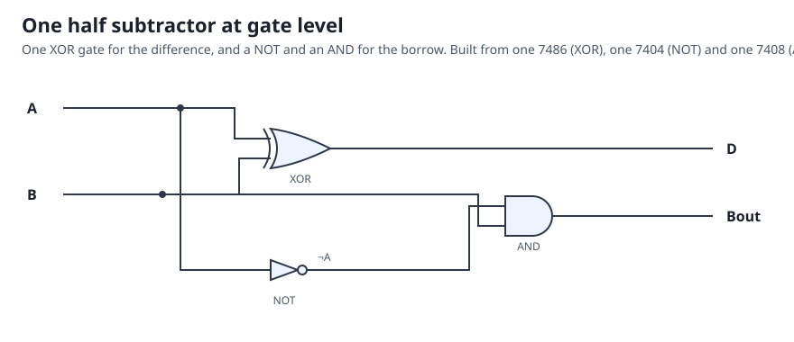
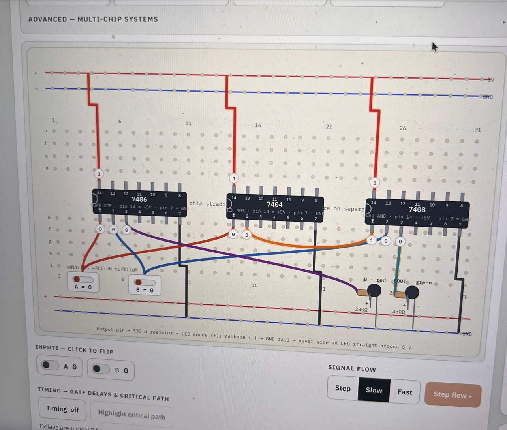
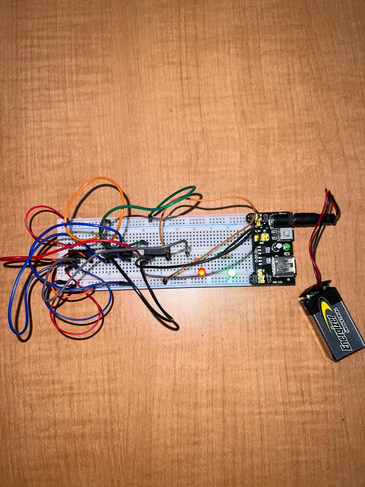

# Module: The Half Subtractor — Difference and Borrow

**Pathway stage:** 04 · Datapath (the hardware the ISA runs on)
**Course:** SCIS 216 Computer Organization and Design (packaged from the Fall 2026 lecture and in-class activity sequence)
**Format:** One bench session · **Level:** Introductory systems

**The arithmetic datapath group:** build 3 of 4. The shared introduction, worksheet, and arithmetic algorithms live in [Inside the ALU](../module-arithmetic-datapath/).
**Previous:** [The Full Adder](../module-full-adder/) · **Next:** [The Full Subtractor](../module-full-subtractor/)

## Why this module exists

Where the half adder opens the addition story, the half subtractor opens the subtraction one: one XOR gate for the difference bit, and an inverter feeding an AND gate for the borrow, computing a single column of A − B. It has no borrow-in, so, like the half adder, it can only ever handle the first column — [the full subtractor](../module-full-subtractor/) exists to fix exactly that. It is also the first build in the group where the 7404 inverter does real work inside an arithmetic circuit.

## Learning objectives

By the end of this module, students can:

- Build a half subtractor from one 7486 (quad XOR), one 7404 (hex inverter), and one 7408 (quad AND), using an inverter to form ¬A for the borrow term.
- Verify all four rows of the half subtractor's truth table on the two LEDs, identifying the borrow row (A = 0, B = 1), the one row where D and Bout are both 1.
- Explain why a half subtractor, like a half adder, can only ever handle the first column of its operation: it has no borrow-in.

## Before you start

- **Prerequisites:** the Full Adder module ([module-full-adder](../module-full-adder/)) — the builds before it in the group — and the single-node wiring habit from the Half Adder module.
- **Parts:** one 7486 (quad XOR), one 7404 (hex inverter), and one 7408 (quad AND), a breadboard and jumper wires, two switches for A and B, two LEDs (red for D, green for Bout) with a 330 Ω resistor in series with each, and a 5 V supply.

## The module files

| File | What it is |
|------|------------|
| `README.md` | This file: the truth table, the schematic, and the build, step by step |
| `diagrams/half-subtractor-schematic.svg` | The gate-level schematic: one XOR gate, one inverter, and one AND gate |
| `images/half-subtractor-breadboard.jpg` | The instructor's build on a breadboard, showing the borrow row A = 0, B = 1 (both LEDs lit) |
| `images/half-subtractor-breadboard-diagram.jpg` | The breadboard wiring diagram from From Gates to Systems, with every chip pin labelled |

The full subtractor's first stage, standing on its own. Where the half adder opens the addition story, the half subtractor opens the subtraction one: one XOR gate for the difference bit, and an inverter feeding an AND gate for the borrow. It computes a single column of A − B. It has no borrow-in, so, like the half adder, it can only ever handle the first column; [the full subtractor](../module-full-subtractor/) exists to fix exactly that.

## The truth table

| A | B | D | Bout |
|---|---|---|------|
| 0 | 0 | 0 | 0 |
| 0 | 1 | 1 | 1 |
| 1 | 0 | 1 | 0 |
| 1 | 1 | 0 | 0 |

D is A ⊕ B: it is 1 when the inputs differ, the same XOR as the half adder's Sum. Bout is ¬A · B: it is 1 only when A is 0 and B is 1, the one row where the column has to borrow.

## What you need

- One 7486 (quad XOR), one 7404 (hex inverter), and one 7408 (quad AND)
- A breadboard and jumper wires
- Two switches for A and B (or jumper wires you move between the ground and +5 V rails)
- Two LEDs: red for D, green for Bout
- Two 330 Ω resistors, one in series with each LED
- A 5 V supply

## The chips

The 7486 and the 7408 are 14-pin quad two-input gates with the pattern used throughout this module: pin 14 is +5 V, pin 7 is ground, and the gates are (pins 1, 2) → 3, (4, 5) → 6, (9, 10) → 8, and (12, 13) → 11. The 7404's inverters are single-input gates on the same power pins: pin 1 → 2, pin 3 → 4, and so on. This build uses one gate of each chip:

| Gate | Inputs | Output | Signal |
|------|--------|--------|--------|
| 7486 gate 1 | pins 1, 2 | pin 3 | D = A ⊕ B |
| 7404 inverter 1 | pin 1 | pin 2 | ¬A |
| 7408 gate 1 | pins 1, 2 | pin 3 | Bout = ¬A · B |

## Wiring, step by step

1. **Power first, but do not switch on yet.** Connect pin 14 of each chip to the +5 V rail and pin 7 of each chip to the ground rail.
2. **Inputs A and B.** Connect switch A to pin 1 of the 7486 and pin 1 of the 7404, and switch B to pin 2 of the 7486 and pin 2 of the 7408. Each input is a single node feeding two chips: join the two pin strips with a short jumper and drive the joined node, because if the chips are wired to an input separately they can disagree about it, and the LEDs will report the disagreement.
3. **The borrow term.** ¬A leaves the 7404's pin 2: connect it to pin 1 of the 7408, where it meets B at pin 2.
4. **The D LED.** D comes out of the 7486's pin 3: connect pin 3 through a 330 Ω resistor to the red LED's anode (the longer leg), and the LED's cathode to the ground rail.
5. **The Bout LED.** Bout comes out of the 7408's pin 3: connect pin 3 through a 330 Ω resistor to the green LED's anode, cathode to the ground rail.
6. **Before you power it:** all three chips have pin 14 on +5 V and pin 7 on ground; A reaches pin 1 of both the 7486 and the 7404, and B reaches pin 2 of both the 7486 and the 7408; each LED's anode reaches its resistor and its cathode reaches ground. An input left unconnected is not a 0: it drifts, and the gates read it as a 1, so a 0 has to be a wire to the ground rail, not a wire removed. Then switch on.

The same circuit laid out on a breadboard, with every chip pin labelled: the breadboard diagram from [From Gates to Systems](https://ebukaoguchi.github.io/gates-to-systems/), showing A = B = 0 with both LEDs dark.

## Test it against the truth table

Set the two switches for each row and check the two LEDs:

| A | B | D LED (red) | Bout LED (green) |
|---|---|-------------|------------------|
| 0 | 0 | off | off |
| 0 | 1 | on | on |
| 1 | 0 | on | off |
| 1 | 1 | off | off |

The photograph shows the borrow row on the instructor's own build: A = 0 and B = 1, the one row where the column borrows, so both LEDs are lit: D = 1 and Bout = 1.

The same board is interactive in [From Gates to Systems](https://ebukaoguchi.github.io/gates-to-systems/), where the switches can be flipped and the highlighted truth-table row follows the inputs. The [full subtractor](../module-full-subtractor/) is two of these half subtractors in series, with an OR gate where their borrows meet.

## The datapath group

This build is one of four breadboard builds in the arithmetic datapath group, taken in build order:

1. [The Half Adder](../module-half-adder/) — one XOR gate and one AND gate: the first column of addition.
2. [The Full Adder](../module-full-adder/) — two half adders and an OR gate: addition with a carry-in.
3. [The Half Subtractor](../module-half-subtractor/) — an XOR, an inverter, and an AND gate: difference and borrow for one column.
4. [The Full Subtractor](../module-full-subtractor/) — two half subtractors in series: subtraction with a borrow-in.

The shared introduction, worksheet, and arithmetic algorithms for the group live in [Inside the ALU](../module-arithmetic-datapath/), which carries the story on into the multiplier and divider designs.

---

*Part of the Systems Labs collection: laboratory modules for computer organization, architecture, and operating systems, maintained by Ebuka Philip Oguchi, Spelman College. Modules may be adopted and remixed with attribution.*
