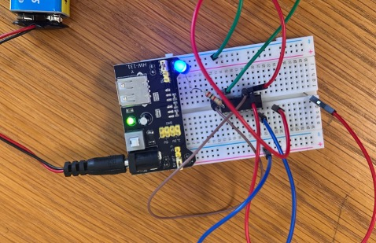
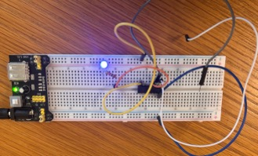
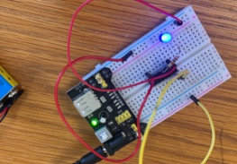

# Module: Logic Gates on a Breadboard — NOT, AND, OR with 74-Series ICs

**Pathway stage:** 04 · Datapath (the hardware the ISA runs on)
**Course:** SCIS 216 Computer Organization and Design — Lab 6 (Spring 2026)
**Format:** One 2–3 hour in-person lab session · **Level:** Introductory systems

## Why this lab exists

Students meet AND, OR, and NOT first as MIPS instructions (`and`, `or`, `nor`) — symbols on a screen. This lab makes the same operations physical: real 74-series logic ICs on a breadboard, inputs they toggle by hand, and an LED that answers. By the end, the truth table is not something they memorised; it is something they watched happen. The closing discussion maps each hardware gate back to its MIPS instruction, closing the loop between the datapath and the ISA.

## Learning objectives

By the end of this lab, students can:

- Wire a breadboard power rail correctly (5V and GND) and seat a DIP IC across the centre gap.
- Build NOT (7404), AND (7408), and OR (7432) gates and verify each truth table by observing LED output.
- Read a resistor colour code and choose a current-limiting resistor for an LED.
- Explain the correspondence between hardware gates and the MIPS instructions `and`, `or`, and `nor`.

## Materials (per bench)

- Breadboard and jumper wires
- 5V power (MB102 breadboard supply module, 9–12V adapter recommended over a 9V battery)
- Logic ICs: 7404 (NOT), 7408 (AND), 7432 (OR)
- LEDs and 330 Ω resistors

## Staged milestones

**Milestone 1 — Power and components.** Identify the parts before touching the board: breadboard rails and terminal strips, the centre gap's purpose, resistor colour codes (worked examples: Red–Violet–Brown–Gold = 270 Ω), LED anode/cathode identification, and why an LED without a current-limiting resistor burns out.

**Milestone 2 — Power setup.** Connect 5V to the positive rail and GND to the ground rail; seat the IC across the centre gap. For all 74xx ICs: pin 14 → Vcc, pin 7 → GND. *Checkpoint: no circuit proceeds until power wiring is verified.*

**Milestone 3 — NOT gate (7404).** Input on pin 1, output on pin 2 → LED → resistor → GND. Expected behaviour: input LOW → LED on; input HIGH → LED off.

**Milestone 4 — AND gate (7408).** Inputs on pins 1 and 2, output on pin 3. Test all four input combinations; the LED lights only when A = 1 and B = 1.

**Milestone 5 — OR gate (7432).** Same wiring pattern as Milestone 4. The LED lights when either input is HIGH.

**Milestone 6 — Close the loop.** Complete the gate ↔ instruction mapping:

| Gate | MIPS instruction |
|------|------------------|
| AND  | `and` |
| OR   | `or`  |
| NOT  | `nor` with `$zero` — e.g. `nor $t0, $t1, $zero` |

## Deliverables

Students submit:

- A photo of each completed circuit on the breadboard
- The completed truth tables for all three gates
- A short written explanation of the observed behaviour

## From the bench

Instructor-built sample circuits for this lab — an MB102 supply module powering the breadboard, the output LED lit, and the 9V battery pack in frame that the instructor notes below warn about:

## Instructor notes

- The 9V battery option works but drains quickly; a wall adapter per bench removes the most common mid-lab failure.
- The single most frequent wiring error is power: an unpowered or mis-railed IC produces "mystery" outputs that students misread as gate behaviour. The Milestone 2 checkpoint exists for this reason.
- The NOT gate's inverted LED behaviour (on when input is LOW) reliably produces the session's best discussion — let students predict before they toggle.

## Source deck

`Lab_6_Spring2026.pptx` — the full slide deck used in class accompanies this module in the repository.

---

*Part of the Systems Labs collection — laboratory modules for computer organization, architecture, and operating systems, maintained by Ebuka Philip Oguchi, Spelman College. Modules may be adopted and remixed with attribution.*
